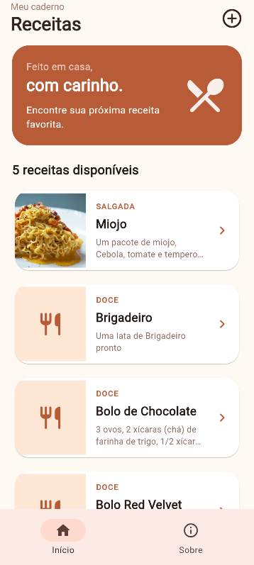
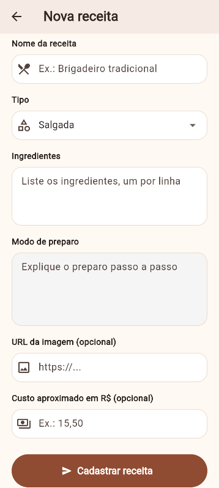
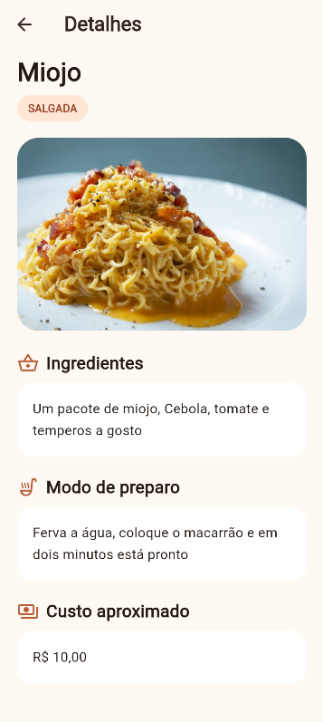

# Livro de Receitas

Aplicativo desenvolvido em Flutter para consultar, cadastrar e visualizar receitas culinárias. O app utiliza uma API para obter os dados das receitas e permite armazenar informações localmente.

## Tecnologias utilizadas

* Flutter
* Dart
* Visual Studio Code
* API de receitas: https://receitasapi-b-2025.vercel.app/

## Como executar o projeto

1. Clone este repositório.

2. Abra a pasta do projeto no Visual Studio Code.

3. No terminal, execute:

   ```bash
   flutter pub get
   ```

4. Para executar o aplicativo, utilize:

   ```bash
   flutter run
   ```

## Telas do aplicativo

### Tela inicial

Adicione uma captura de tela da tela inicial do aplicativo na pasta `assets`, com o nome `print1.png`.



### Cadastro de receita

Adicione uma captura de tela da tela de cadastro de receitas na pasta `assets`, com o nome `print2.png`.



### Detalhes da receita

Adicione uma captura de tela da tela de detalhes da receita na pasta `assets`, com o nome `print3.png`.



## APK do aplicativo

Clique no link abaixo para baixar o aplicativo:

[**Baixar APK**](assets/app-release.apk)
